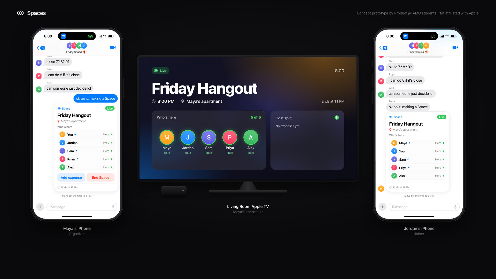

# Spaces: interactive prototype

**Live:** https://spaces.patricksemler.dev (also https://patricksemler.dev/spaces/)

Spaces is a temporary Space that starts in the group chat, so a friend group can plan and run one hangout across their Apple devices. When the hangout ends, it turns itself off.

This prototype shows three devices at once: Maya's iPhone (organizer), Jordan's iPhone (joiner), and the Apple TV in Maya's apartment. All three run on **one shared state store**, so whatever happens on one device shows up on the others in the same frame. That's the point we want judges to see: Spaces is **live and cross-device**. It isn't a static invite.

## How to use it
- **Guided** (default): press **→** or **Next** to step through 6 beats. Each beat plays its taps for you, and a soft finger ripple shows where the tap lands.
- **Free Play**: press **F**, or tap any control on a device. Every control works. Sam, Priya, and Alex respond on their own, and **Skip to 8 PM** starts the hangout.
- **On a phone**: you see one device at a time. Use the Maya / Jordan / TV switcher. It also follows whichever device is being tapped.

| Key | Action |
|---|---|
| ← / → | Previous / next beat |
| Space | Pause or resume autoplay (on by default; add `?autoplay=0` to start paused) |
| 1–6 | Jump to a beat |
| F | Switch between Guided and Free Play |
| H | Hide controls and captions (for clean screen recording) |
| R | Reset |

URL parameters: `?beat=3` opens a beat and plays it, `&static=1` jumps straight to the beat's end state, `&clean=1` hides the controls, and `&mode=free` opens in Free Play.

## Beats
| # | Beat | PRD requirements |
|---|---|---|
| 0 | Today: the plan stalls in the group chat | Problem |
| 1 | Maya creates a Space from the Messages `+` menu | FR-01 |
| 2 | One-tap join, live time votes ("4 of 5 free at 8 PM"), lock the time | FR-02, FR-03 |
| 3 | 8 PM: Dynamic Island, Lock Screen Live Activity, and the TV board wake up together. Jordan declines location, which is off by default | FR-04, FR-06, FR-09, FR-10 |
| 4 | Pizza $40 → $8 each on every screen. Jordan pays back with an Apple Pay–style sheet | FR-05 |
| 5 | Maya ends the Space. Sharing stops, the TV goes back to Home, and a "Keep plan?" summary appears | FR-07 |

## Tech
Plain HTML, CSS, and JS using native ES modules. There's no build step and no runtime dependencies, and the repo root is what gets deployed (GitHub Pages).

- `js/store.js`: the pure reducer, the selectors (vote counts, per-person split, paid count), and the store
- `js/devices/*.js`: each device builds its DOM once, and `update(state)` only changes classes and text, so CSS springs animate on every device together
- `js/beats.js`: the guided scripts. `js/director.js`: the step bar, keyboard shortcuts, autoplay, Free Play, and the mobile switcher
- Motion uses CSS `linear()` spring curves on transform and opacity. `prefers-reduced-motion` is respected.

Run it locally with `python3 -m http.server`, then open http://localhost:8000.

---
Concept prototype by Product@TAMU students (Fall 2026). Not affiliated with Apple. No Apple logos or assets are used, and all glyphs are hand-drawn approximations.
